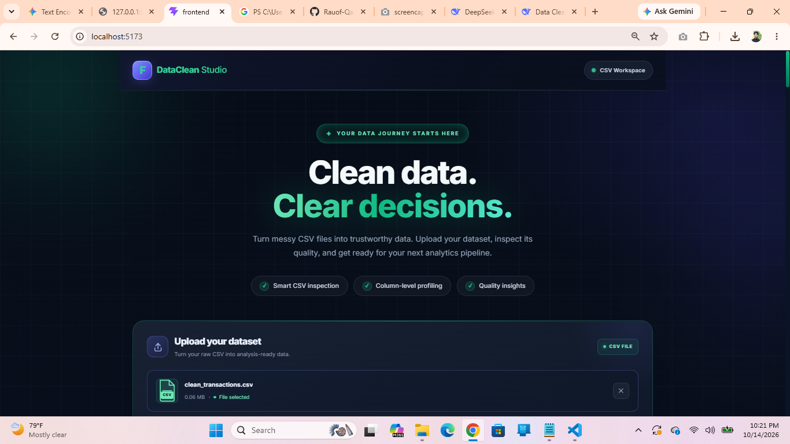
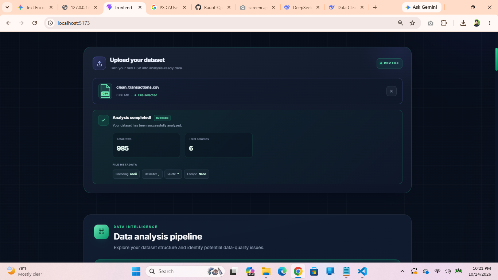
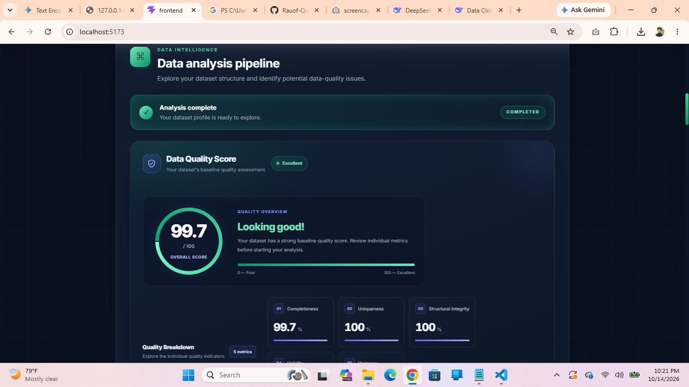
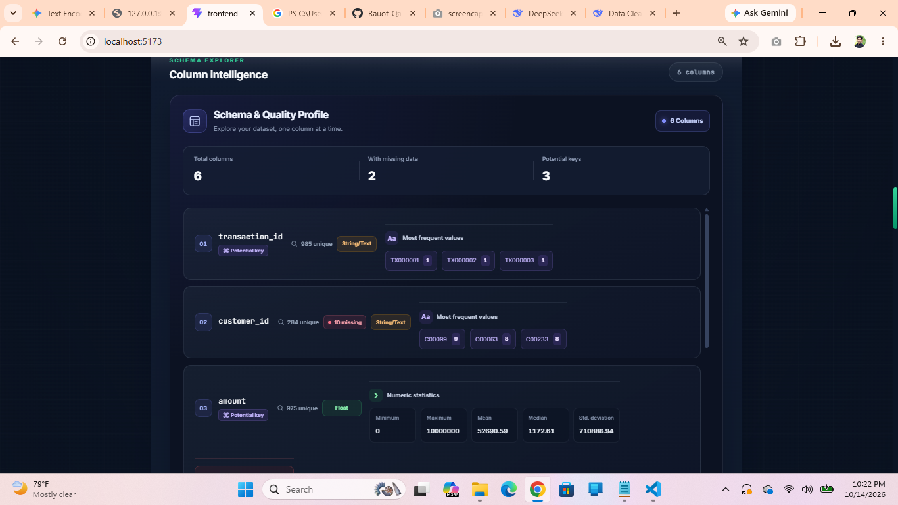
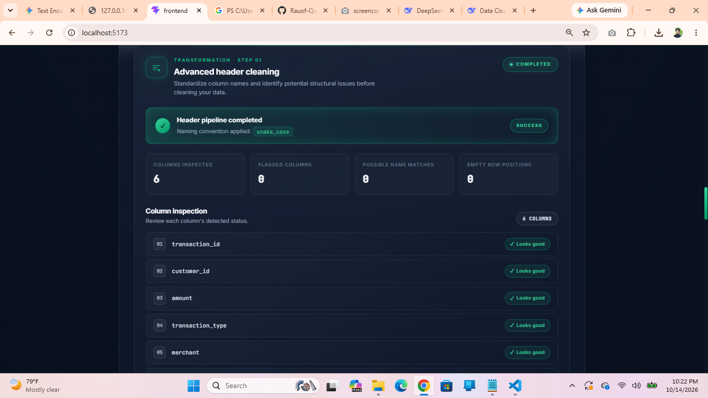
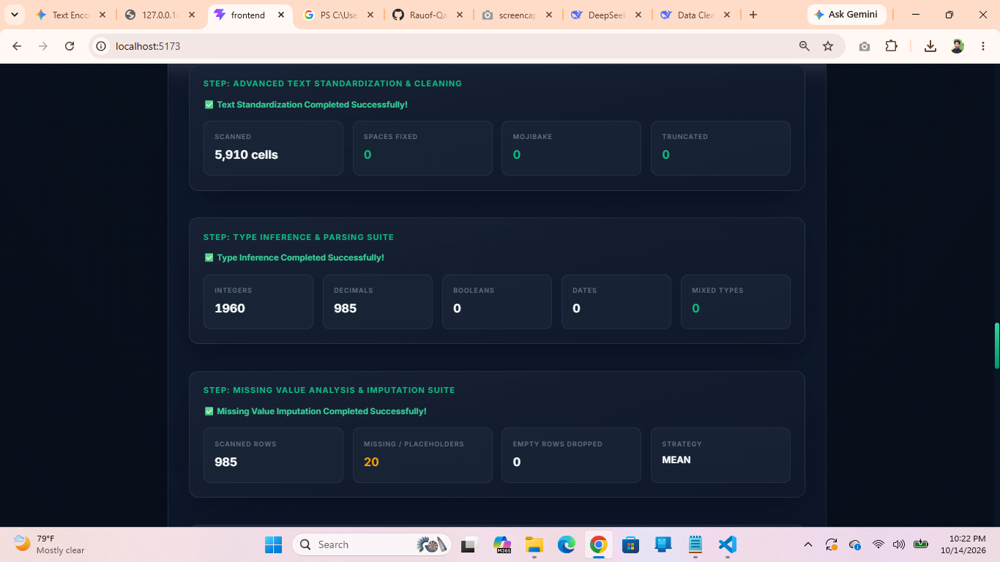
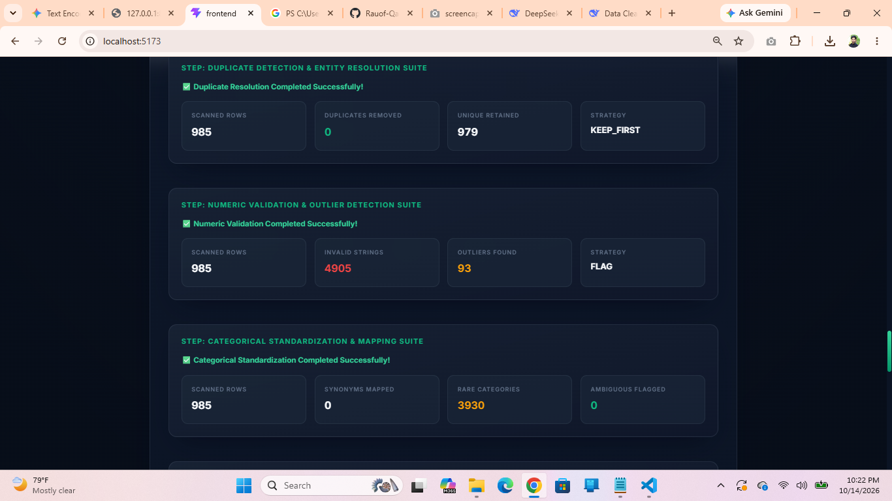
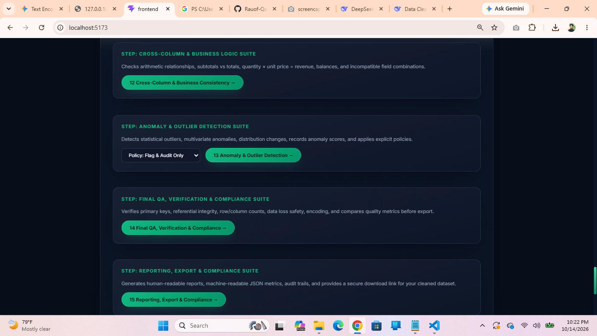

<div align="center">

# 🧹Enterprise Data Cleaning & Validation Studio

An advanced, full-stack enterprise data cleaning, automated validation, anomaly detection, and compliance reporting platform. Built with a high-performance FastAPI backend engine and a modern React + Vite frontend interface featuring an emerald green theme.

</div>

<p align="center">
  
  
  
  
  
</p>











---

## 🚀 Key Features

* **File Ingestion & Table Structure**: Robust CSV parsing, delimiter detection, and header trimming.
* **Automated Data Cleaning**: Null/missing value imputation, duplicate removal, type coercion, and text standardization.
* **Advanced Validation & Anomaly Detection**: Schema conformance, business rules, statistical IQR/Z-score outlier detection.
* **Compliance & Reporting**: Audit-ready CSV/JSON exports with comprehensive quality metrics and rule logs.

---

## 🛠️ Tech Stack

* **Frontend**: React 18, Vite
* **Backend**: Python 3.11+, FastAPI, Pydantic
* **Styling**: Modern CSS (Emerald Green Theme)


---
##  Backend Setup

* cd backend
* python -m venv .venv
* .venv\Scripts\Activate
* pip install -r requirements.txt
* uvicorn main:app --reload


---
## Frontend Setup

* cd frontend
* npm install
* npm run dev

---
---
## Folder Structure

data-cleaning-web/
├── backend/
│   ├── cleaning_pipeline/
│   │   ├── anomaly_detection.py
│   │   ├── categorical_standardization.py
│   │   ├── cross_column_consistency.py
│   │   ├── datatype_and_formateconversion5.py
│   │   ├── domain_validation.py
│   │   ├── duplicate_resolution.py
│   │   ├── file_ingestion_and_parsing1.py
│   │   ├── final_qa_verification.py
│   │   ├── initial_data_profiling2.py
│   │   ├── missing_value_imputation6.py
│   │   ├── numeric_validation_outliers.py
│   │   ├── reporting_export.py
│   │   ├── table_structure_and_headers3.py
│   │   ├── temporal_validation.py
│   │   └── text_and_string_cleaning4.py
│   ├── uploads/
│   ├── main.py
│   └── requirements.txt
├── frontend/
│   ├── public/
│   ├── src/
│   │   ├── assets/
│   │   ├── components/
│   │   ├── App.css
│   │   ├── App.jsx
│   │   ├── index.css
│   │   └── main.jsx
│   ├── index.html
│   ├── package.json
│   └── vite.config.js
└── .gitignore
## 📥 Installation & Setup

### 1. Clone the Repository
```bash
git clone [https://github.com/Rauof-Qadir/One-click-data-cleaning-pipeline.git](https://github.com/Rauof-Qadir/One-click-data-cleaning-pipeline.git)
cd One-click-data-cleaning-pipeline